<p align="center">
  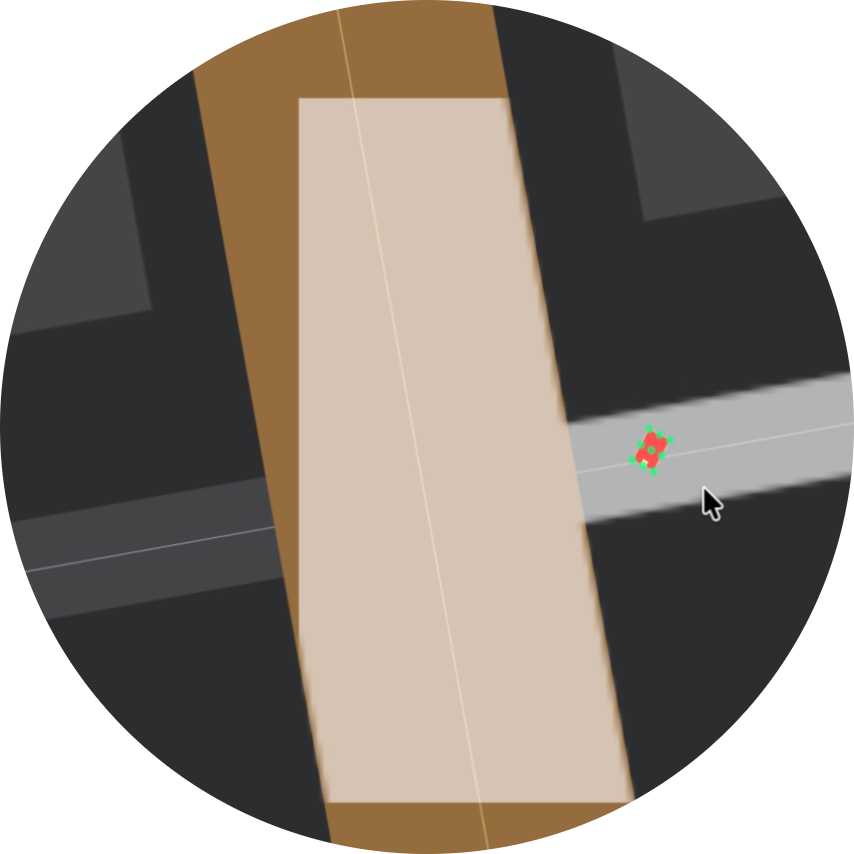
</p>

<h1 align="center">MetaTraffic</h1>

<p align="center">
  <b>Procedural 3D cities as reinforcement-learning environments for autonomous driving and multi-agent traffic.</b>
</p>

<p align="center">
  <a href="https://github.com/YangLiu68/MetaTraffic/actions/workflows/tests.yml"></a>
  
  
  
  
  <a href="LICENSE"></a>
</p>

<p align="center">
  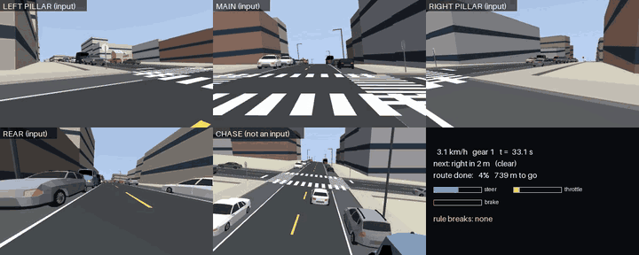
  <br/>
  <sub>A camera-only agent turning right in a generated city. Top row and bottom left: the onboard cameras that form
  the observation. Bottom middle: a chase view for humans. Bottom right: the live HUD with the route command,
  the agent's controls and the traffic-rule monitor.</sub>
</p>

MetaTraffic grows a complete city from a single integer seed (terrain, coastline and rivers, a
lane-level road network with junction control, districts, thousands of buildings, bridges and
an optional elevated highway) and fills it with a traffic and pedestrian microsimulation,
incidents and weather. On top of that world it exposes two reinforcement-learning environments:

* **`DrivingEnv`**, a single-agent, [Gymnasium](https://gymnasium.farama.org/)-compatible
  self-driving environment. A physically simulated car (engine, gearbox, brakes, Ackermann
  steering, tyre contacts) sees the city only through onboard cameras and is controlled with raw
  steer, throttle, brake and gear. A traffic-rule monitor scores every step.
* **`TaxiEnv`**, a multi-agent ride-hailing environment with a
  [PettingZoo](https://pettingzoo.farama.org/)-style parallel API, in which a fleet of taxis
  compete for passengers in the same simulated traffic.

The world is rendered and simulated in **MuJoCo** and can be exported to **NVIDIA Isaac Sim**
as USD. Every city, episode, route, traffic pattern, incident and weather condition is
reproducible from seeds, which makes held-out evaluation on unseen cities a one-line change.

---

## Contents

- [Highlights](#highlights)
- [Demos](#demos)
- [Gallery](#gallery)
- [Quick start](#quick-start)
- [Architecture](#architecture)
- [World generation](#world-generation)
- [Traffic, pedestrians and incidents](#traffic-pedestrians-and-incidents)
- [The driving environment (`DrivingEnv`)](#the-driving-environment-drivingenv)
- [The multi-agent taxi environment (`TaxiEnv`)](#the-multi-agent-taxi-environment-taxienv)
- [Simulator backends](#simulator-backends)
- [Scale and performance](#scale-and-performance)
- [Reproducibility and testing](#reproducibility-and-testing)
- [Command-line reference](#command-line-reference)
- [Repository layout](#repository-layout)
- [The original 2D environment](#the-original-2d-environment)
- [Limitations and roadmap](#limitations-and-roadmap)
- [Acknowledgements and license](#acknowledgements-and-license)

---

## Highlights

| | |
|---|---|
| **Seeded cities** | One seed fixes the whole city. A sampled *profile* gives every city its own character (terrain, water, district mix, traffic and pedestrian density, highway); any factor can be pinned. A typical city covers about 3.5 x 2.2 km with ~125 km of roads. |
| **Lane-level road network** | 8-lane arterials with medians, turn bays and dual left-turn lanes; 4-lane side streets with kerb parking; ~3,000 driving lanes, ~7,600 junction turn paths with conflict sets and ~26,000 parking spots per city. |
| **Junction control** | Fixed-time traffic lights (with yellow and all-red), two-way and all-way stops, signal outages. |
| **Microsimulation** | IDM car-following, an intersection manager, discretionary and mandatory lane changes, kerb parking, congestion-aware routing, 14 vehicle types, pedestrians who cross on zebras and sometimes jaywalk. |
| **Incidents and weather** | Construction zones and closures, breakdowns, crashes, emergency vehicles, red-light runners, aggressive cut-ins, double parking; clear, overcast, dusk, night, rain (lower road friction) and fog. |
| **Physical ego car** | MuJoCo multibody car with an engine torque curve, 5-speed gearbox and reverse, brakes, rate-limited Ackermann steering and four tyre contacts; it climbs and descends real terrain. |
| **Sensors** | A Tesla-style rig of 8 cameras (main, wide, narrow, two pillars, two repeaters, rear); any subset at any resolution. |
| **Rule monitor** | Collisions, red lights, stop signs, wrong way, off-road, speeding and route deviation, logged as timestamped events and used in the reward and the evaluation metrics. |
| **Two RL interfaces** | Gymnasium spaces for single-agent driving, a PettingZoo-style parallel API for the taxi fleet. |
| **Tooling** | Privileged autopilot for demonstrations and baselines, demonstration recorder, closed-loop evaluation harness, multi-camera video recorder, MJCF and USD export. |

---

## Demos

All clips run in generated cities with live traffic, pedestrians and weather. The HUD shows speed,
gear, the route command, route progress, the controls and the rule monitor.

<table>
  <tr>
    <td width="50%">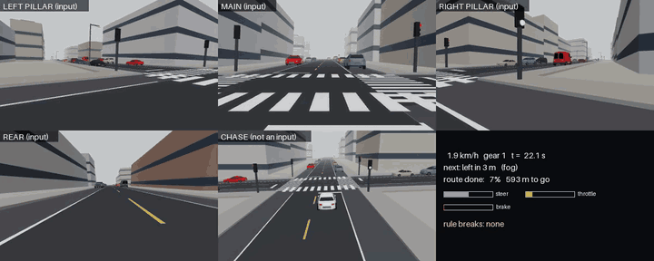</td>
    <td width="50%">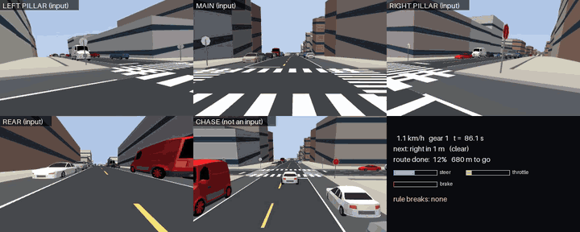</td>
  </tr>
  <tr>
    <td><sub><b>Left turn in fog</b> on a green light: the agent follows the route command
    <code>left</code> through a signalised arterial junction.</sub></td>
    <td><sub><b>Right turn at a stop sign</b>: the agent stops at the line, then turns into a
    residential street.</sub></td>
  </tr>
  <tr>
    <td colspan="2">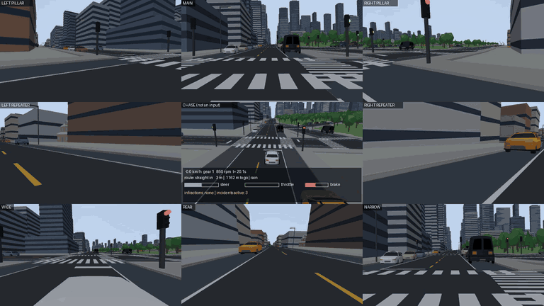</td>
  </tr>
  <tr>
    <td colspan="2"><sub><b>The full 8-camera rig</b> around a chase view, driven by the built-in
    autopilot through a hilly city in rain.</sub></td>
  </tr>
</table>

Full-length videos (MP4, from the [v0.3.0 release](https://github.com/YangLiu68/MetaTraffic/releases/tag/v0.3.0)):

| Video | City | Length | What happens |
|---|---|---|---|
| [Two right turns](https://github.com/YangLiu68/MetaTraffic/releases/download/v0.3.0/agent_city6_two_right_turns.mp4) | 6, clear | 100 s | Right turn at 0:36, right turn at a stop sign at 1:31 |
| [Left turn in fog](https://github.com/YangLiu68/MetaTraffic/releases/download/v0.3.0/agent_city2_left_turn_fog.mp4) | 2, fog | 45 s | Signalised left turn at 0:25 |
| [Full route, city 6](https://github.com/YangLiu68/MetaTraffic/releases/download/v0.3.0/agent_city6_full_route_150s.mp4) | 6, clear | 150 s | Straight crossings and a left turn at 1:16 |
| [Full route, city 2](https://github.com/YangLiu68/MetaTraffic/releases/download/v0.3.0/agent_city2_full_route_150s.mp4) | 2, clear | 150 s | Dense arterial traffic |
| [8-camera rig, rain](https://github.com/YangLiu68/MetaTraffic/releases/download/v0.3.0/camera_rig_city7_hilly_rain.mp4) | 7, hilly, rain | 75 s | Autopilot, all eight cameras |
| [8-camera rig, clear](https://github.com/YangLiu68/MetaTraffic/releases/download/v0.3.0/camera_rig_city4_clear.mp4) | 4, clear | 60 s | Autopilot, all eight cameras |

---

## Gallery

<p align="center">
  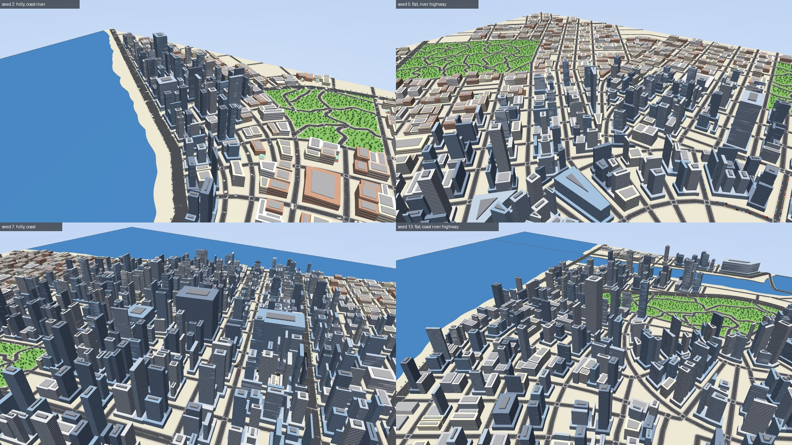
  <br/><sub>Four seeds, four cities: hills, coastlines, rivers, parks, a downtown of towers fading into
  residential blocks, and (seeds 5 and 13) an elevated highway.</sub>
</p>

<p align="center">
  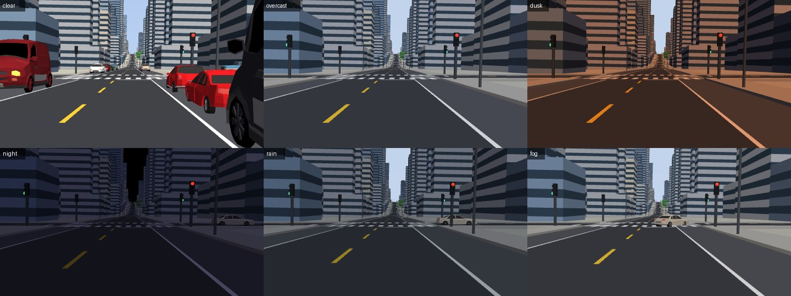
  <br/><sub>One street through the main camera in all six weather and lighting conditions.</sub>
</p>

<table>
  <tr>
    <td width="50%">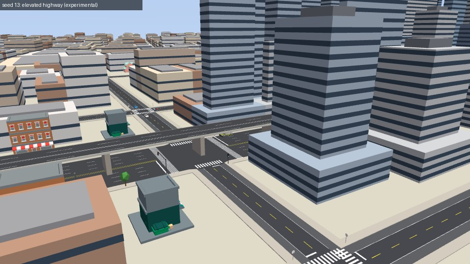</td>
    <td width="50%">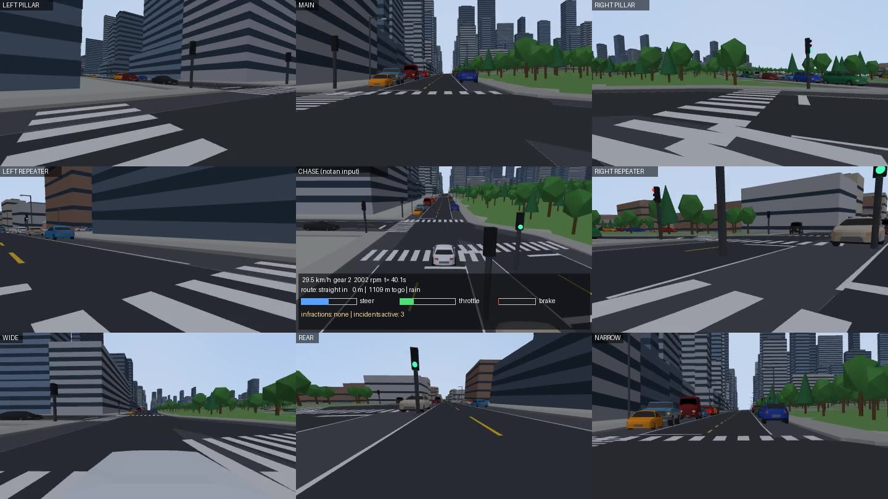</td>
  </tr>
  <tr>
    <td><sub>The experimental elevated highway: a 2+2-lane viaduct above an arterial, with piers,
    barriers and median ramps.</sub></td>
    <td><sub>The eight-camera rig with the HUD; each tile is one camera.</sub></td>
  </tr>
</table>

---

## Quick start

```bash
git clone https://github.com/YangLiu68/MetaTraffic.git && cd MetaTraffic
pip install -e ".[mujoco,assets]"            # numpy, shapely, pillow, mujoco, gymnasium, trimesh
python -m metatraffic3d assets fetch          # optional: 44 Poly Pizza models (12 MB); procedural fallbacks otherwise
```

Build a city, look at it, drive in it:

```bash
python -m metatraffic3d build --seed 4 --png map.png                      # city summary + top-down map
python -m metatraffic3d mjcf --seed 4 --out scenes/seed4                  # MuJoCo scene
python -m mujoco.viewer --mjcf scenes/seed4/scene.xml                     # fly around it
python -m metatraffic3d drive-demo --seed 7 --weather rain --seconds 60 --out demo.mp4   # 8-camera video
python -m metatraffic3d usd --seed 4 --out city.usd                       # Isaac Sim (needs usd-core)
```

Use the driving environment from Python:

```python
from metatraffic3d.config import SimConfig
from metatraffic3d.driving.env import DrivingEnv

cfg = SimConfig()
cfg.map.seed = 4                                  # the city
env = DrivingEnv(cfg, image_size=(160, 96))       # 4 cameras by default

obs, info = env.reset(seed=0)                     # the episode: route, traffic, weather, incidents
while True:
    action = env.expert_action()                  # or your agent: {"control": [steer, throttle, brake], "gear": g}
    obs, reward, terminated, truncated, info = env.step(action)
    if terminated or truncated:
        print(info["reason"], info["privileged"]["infractions"])
        break
```

And the multi-agent taxi environment:

```python
from metatraffic3d.marl.taxi_env import TaxiEnv

env = TaxiEnv(cfg, seed=0)
obs, infos = env.reset(seed=0)
while env.agents:
    actions = {a: int(obs[a]["mask"].argmax()) for a in env.agents}   # first legal option
    obs, rewards, terminations, truncations, infos = env.step(actions)
```

---

## Architecture

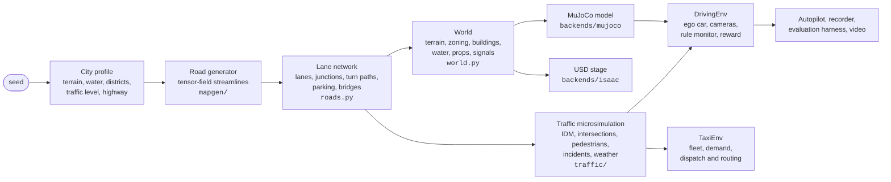

The road network, traffic simulation and taxi environment are pure Python (numpy + shapely);
MuJoCo is only needed for physics and rendering, and the USD export only needs `usd-core`.

---

## World generation

Everything is drawn from the seed; nothing is placed by hand. `profile.py` samples the global
character of each city, and any factor can be pinned through `SimConfig().profile`:

| Factor | Distribution |
|---|---|
| Terrain | flat 35%, rolling 30%, hilly 25%, steep 10% (hills fade near water; grades capped near 25%) |
| Water | coastline 60%, river 65% (independent) |
| Districts | Dirichlet mix of CBD, commercial, residential and industrial |
| Traffic / pedestrian density | 0.6-1.4x / 0.5-1.5x |
| Elevated highway (experimental) | 30% |

The pipeline:

1. **Road graph.** `mapgen/` is a Python port of
   [ProbableTrain/MapGenerator](https://github.com/ProbableTrain/MapGenerator): roads are
   streamlines of a tensor field built from grid and radial basis fields, traced at four levels
   (main, major, minor roads and park paths), with coastline and river polygons. Output is the
   original generator's SVG format, so 2D and 3D use the same maps.
2. **Lane network** (`roads.py`). Graph edges become directed road segments with real lanes.
   Main roads have **4 driving lanes per direction**, a median, a right-turn lane and dual
   left-turn lanes; side streets have one driving lane and one kerb parking lane per direction.
   Every junction gets turn paths (connectors) with geometric conflict sets; every lane is
   guaranteed a way out; kerbs are filled to at most 80% so there is always space to pull in.
3. **Districts** (`zoning.py`) come from smooth fields (distance to downtown, main-road frontage,
   waterfront, outskirts, plus seeded noise) and decide building types and junction control.
4. **Buildings** (`heights.py`): detached houses with pitched roofs, apartment blocks, shops with
   glass ground floors and awnings, offices, towers with podiums rising toward downtown,
   warehouses. Poly Pizza models replace procedural ones where they fit.
5. **Junction control** (`traffic/control.py`): lights where arterials cross (fixed-time, two
   phases, yellow and all-red), two-way stops where a side street meets an arterial, all-way
   stops in residential streets, some lights downtown.
6. **Terrain and water** (`terrain.py`): a seeded height field that carries the cars in physics;
   sea with a beach strip, a recessed river channel with embankment walls, bridges with decks,
   railings and piers.
7. **Elevated highway** (experimental): when the profile has one, a 2+2-lane 80 km/h viaduct
   runs above the longest straight arterial, grade-separated, with median ramps at both ends.
   It is part of routing, physics and rendering.

A typical city (seed 4, as built by `python -m metatraffic3d build --seed 4`):

| Quantity | Value |
|---|---|
| Extent | 3.5 x 2.2 km |
| Road length | 125 km (2.6 highway, 9.3 main, 25.6 major, 87.4 minor) |
| Graph | 702 junctions, 1,235 road segments |
| Lanes | 2,994 driving lanes, 2,294 parking lanes, 7,625 junction turn paths |
| Parking | 26,278 kerb spots |
| Structures | 7 bridges, 710 signal heads, 4,597 street props |
| Build time | 5.6 s (9.0 s for a hilly city), single core |

---

## Traffic, pedestrians and incidents

`traffic/` is a pure-Python microsimulation on the lane network, stepped together with the
physics.

* **Car-following**: the Intelligent Driver Model (max acceleration 1.5 m/s², comfortable
  deceleration 2.5 m/s², time headway 1.2 s, minimum gap 2 m), scaled per vehicle type and by
  weather; turn speeds follow a lateral-acceleration limit.
* **Intersections**: vehicles request a turn path ~35 m before a junction; the manager grants
  it when no conflicting path is occupied, keeps the box clear, gives main roads priority,
  obeys lights and stop signs, and stops starvation (a request waiting 25 s blocks newer
  conflicting ones).
* **Lane changes and parking**: mandatory lane changes for turns, discretionary ones for speed,
  kerb pull-in and pull-out with gap checks.
* **Routing**: shortest paths with congestion-aware edge costs (exponential moving average of
  observed travel times); trip ends weighted by floor area, so downtown attracts traffic.
* **Vehicle types (14)**: sedan, SUV, hatchback, pickup, van, taxi, sports car, police car,
  delivery van, truck, bus, garbage truck, ambulance and fire truck, each with its own size and
  performance.
* **Pedestrians** walk sidewalks, turn corners and cross on zebras (on red at lights, when clear
  at stops); a share jaywalk, and some of those step out without looking.
* **Incidents** at seeded rates: construction (lane closure with a cone taper and barriers,
  kerb lane coned off, or a full street closure), broken-down cars, crashes, emergency vehicles
  on a siren run (others pull aside; priority at junctions), signal outages (the junction
  becomes an all-way stop), hard braking, red-light runners, aggressive cut-ins and delivery
  double-parking.
* **Weather and lighting**: clear, overcast, dusk, night (dim, street-lit), rain (road friction
  0.65) and fog; drivers keep longer gaps and slow down in bad conditions.

---

## The driving environment (`DrivingEnv`)

`metatraffic3d.driving.env.DrivingEnv` follows the Gymnasium API (`reset(seed, options)` ->
`(obs, info)`, `step(action)` -> `(obs, reward, terminated, truncated, info)`) and declares
`observation_space` and `action_space`.

### Ego vehicle

| | |
|---|---|
| Body | 1.3 t chassis, four tyres with contact physics, rear-wheel drive |
| Powertrain | engine torque curve peaking at 330 N m, 5-speed gearbox + reverse + neutral, final drive 3.9 |
| Steering | Ackermann geometry, rate-limited |
| Measured | 0-100 km/h in 10.7 s, 50-0 km/h in 10.6 m, slows on a 12% grade |
| Timing | control at 10 Hz (`dt = 0.1 s`), physics at 500 Hz (50 substeps) |

### Observation

| Key | Shape | Content |
|---|---|---|
| `images` | `(n_cams, H, W, 3)` uint8 | camera images; default 4 cameras (main, both pillars, rear) at 160x96 |
| `state` | `(12,)` float32 | speed, engine rpm, gear one-hot (R, N, 1-5), steering angle, road pitch, gear-shift flag |
| `command` | `(7,)` float32 | route command one-hot (follow, left, right, straight, U-turn, arrive) and the distance to the next junction |

The camera rig (`cameras.py`) mirrors a production layout; any subset can be selected with
`cameras=(...)` and any resolution with `image_size=(W, H)`:

| Camera | Mount | Yaw | Horizontal FOV |
|---|---|---|---|
| `front_main` | windscreen | 0° | 50° |
| `front_wide` | windscreen | 0° | 120° |
| `front_narrow` | windscreen | 0° | 35° |
| `pillar_left` / `pillar_right` | B-pillars | ±60° | 90° |
| `repeater_left` / `repeater_right` | front fenders, facing back | ±140° | 75° |
| `rear` | tailgate | 180° | 120° |

### Action

```python
{"control": Box(low=[-1, 0, 0], high=[1, 1, 1]),   # steer, throttle, brake
 "gear":    Discrete(7)}                            # R, N, 1, 2, 3, 4, 5
```

Direct actuation, no speed or waypoint set-points: the agent has to manage the gearbox, hold
the car on slopes and modulate the brake itself.

### Reward

| Term | Value |
|---|---|
| Route progress | +0.1 per metre of route distance gained; a wrong turn that lengthens the route costs the full detour (up to 100 m per step) |
| Comfort | -0.001 x \|longitudinal acceleration\| - 0.002 x \|yaw rate\| per step |
| Collision | -20 per contact (vehicle, pedestrian, parked car or construction object) |
| Red light | -10 |
| Stop sign (no full stop) | -5 |
| Wrong way / route deviation | -0.5 each |
| Off-road / speeding | -0.3 / -0.05 per event |
| Arrival | +10 |

Each rule penalty is set above the time that breaking the rule saves (a full stop at a stop
sign delays about 3 reward units of progress, waiting out a red light up to about 9 at
`gamma = 0.99`), so ignoring the rules never pays.

### Episode structure

| | |
|---|---|
| Start | a random driving lane, with a gap check against parked and moving traffic |
| Goal | a random kerb point 500-1,400 m away (configurable `route_m`), reached via the planned route |
| Randomised per episode | route, traffic and pedestrian state (20 s warm-up), incidents, weather (clear 40%, overcast 15%, night 13%, dusk 12%, rain 12%, fog 8%) |
| Terminated | arrival; collision with a vehicle, pedestrian or parked car; 2 s off the road |
| Truncated | 60 s without moving; time limit (default 240 s) |

### Rule monitor

`ego.py` projects the car onto the lane or turn path it physically occupies every step and
logs infractions as `{"kind", "t", ...}` events in `info["privileged"]["infractions"]`:

| Infraction | Definition |
|---|---|
| `collision` | contact with another vehicle, a pedestrian, a parked car or a construction object (once per contact) |
| `red_light` | entering a signalised junction on red |
| `stop_sign` | entering a stop-controlled junction without stopping at the line |
| `wrong_way` | heading more than ~125° off the lane direction while moving |
| `off_road` | leaving the paved area, or more than 3 m from any lane |
| `speeding` | more than 15% (+1 m/s) over the lane's speed limit |
| `route_deviation` | ending up on a different road segment than the planned route |

`info["privileged"]` also carries the autopilot's action for the current state, the remaining
route length, the pose, speed, weather and time: useful for imitation labels, reward shaping
or debugging, and never part of the observation.

### Autopilot, data collection and evaluation

* **Autopilot** (`expert.py`): a privileged rule-based driver in the style of the CARLA autopilot
  used by LBC, Roach and TransFuser: pure pursuit on the planned lane path, lane changes for
  turns, speed from the simulator's own car-following advice (lights, stop signs, pedestrians,
  closures and the car ahead) and an automatic gear schedule. It outputs exactly the
  environment's action format.
* **Demonstration recorder** (`collect`): records episodes (JPEG camera frames, state, command,
  action labels). It supports DART-style action noise (the executed action is perturbed, the
  label stays clean) and mixed-control rollouts in which an external agent and the autopilot
  hand over control at random intervals, so the data covers the states an agent actually reaches.
* **Closed-loop evaluation** (`evaluate`): fixed route seeds per city (`900000 + city * 100 +
  episode`), so any agent can be compared on identical routes. Metrics: arrival rate, route
  completion (1 - remaining / initial route length), distance, speed, and every infraction per
  kilometre. Reference on the standard protocol (cities 6 and 2, 5 routes each of 300-800 m,
  150 s limit): the privileged autopilot completes 70% of the route on average with zero
  collisions.
* **Video** (`drive-demo`): renders the 8-camera mosaic with a chase view and HUD; with
  `--policy` it replays any evaluation route with an agent checkpoint instead of the autopilot.

---

## The multi-agent taxi environment (`TaxiEnv`)

`metatraffic3d.marl.taxi_env.TaxiEnv` implements the PettingZoo `ParallelEnv` interface (no
PettingZoo dependency): `reset(seed)` -> `(obs, infos)`, `step(actions)` ->
`(obs, rewards, terminations, truncations, infos)` over agents `taxi_0 ... taxi_{n-1}`, with
Gymnasium spaces per agent.

Taxis drive in the same microsimulation as the background traffic. Passengers appear at kerbs
(more often near tall buildings), each with a patience of 4-10 minutes. Agents act only when a
decision is due:

* **dispatch**: an idle taxi picks one of the nearest open requests, or waits;
* **routing**: approaching a junction with several sensible ways on, the taxi picks the next
  street (options within 1.5x of the best ETA).

All other agents receive a single "continue" option for that step, so episodes run at
simulation speed while decisions stay sparse.

| | |
|---|---|
| Observation | `options` (k x 23 feature rows, one per choice), `mask` (legal options), `self` (14 features), `kind` (none / dispatch / route) |
| Action | `Discrete(k)`: the index of an option (k = 7) |
| Reward | fare on delivery (1 + 0.5 per km), minus driving time, minus passenger waiting at pickup, penalties for abandoned pickups and for double-parking when no kerb spot is free |
| Defaults | 5 taxis, 30-minute episodes, 2 requests per minute, 120 background cars, 150 pedestrians |

Because both decision kinds are option lists, a single scoring network can serve dispatch and
routing; the environment works with independent learners, parameter sharing or a centralised
critic. Heuristic baselines in `marl/baselines.py`, on city 4 over 20 held-out demand seeds
(`python -m metatraffic3d eval-taxi`):

| Baseline | Deliveries / taxi-hour | Abandoned pickups / episode | Earnings / episode |
|---|---|---|---|
| random | 0 | 28.0 | 0 |
| greedy (nearest passenger, live ETAs) | 4.54 | 6.9 | 19.6 |
| greedy (free-flow ETAs) | 4.64 | 7.1 | 19.7 |
| greedy-feasible (skips passengers it cannot reach in time) | 4.70 | 4.9 | 20.1 |

---

## Simulator backends

**MuJoCo** (`backends/mujoco/`, fully tested). One compiled model per city. Static geometry
is visual only, while a plane or height field carries the cars. Traffic and pedestrians are
pooled mocap bodies, and unused ones are not drawn. Meshes are merged per material with a colour-palette
texture, traffic-light lamps are lit through materials, and fog, skybox and shadows follow the
weather. `mjcf` writes a standalone scene that opens in `python -m mujoco.viewer`.

**NVIDIA Isaac Sim** (`backends/isaac/`). USD export with instancing, materials, lamps, vehicle
and pedestrian prototypes, the camera rig and a physics ground, verified with `usd-core`; a
runner script for Isaac Sim 4.x/5.x streams the traffic simulation into the stage (it needs an
NVIDIA GPU and has not been run in this repository's CI). See
[`backends/isaac/README.md`](metatraffic3d/backends/isaac/README.md).

**Assets.** Vehicles, people, street furniture, construction props and some buildings are
[Poly Pizza](https://poly.pizza) models (32 CC0, 12 CC-BY 3.0), downloaded on demand into
`~/.cache/metatraffic3d/polypizza` and credited in [`CREDITS.md`](CREDITS.md). Every asset has a
procedural fallback, so the simulator runs without any download.

---

## Scale and performance

Measured on an Apple M4 (16 GB), city seed 4:

| | |
|---|---|
| City build (road network, zoning, meshes) | 5.6 s |
| `DrivingEnv` construction (MuJoCo compile) | 3.0 s |
| MuJoCo model | 1,016 bodies, 2,595 geoms, 117 meshes, 8 cameras |
| Population | 120 background vehicles, 150 pedestrians, plus incidents |
| Camera rendering | ~22 ms per 160x96 image (no shadows) |
| `DrivingEnv.step` with 4 cameras | ~88 ms (~11 steps/s); rendering is almost all of it |
| `TaxiEnv` | no rendering; runs at microsimulation speed |

Rendering dominates, so camera count and resolution set the throughput; fewer or smaller
cameras scale it up accordingly, and environments are independent processes, so they run in
parallel.

---

## Reproducibility and testing

* **Same seed, same city.** `SimConfig().map.seed` fixes the city; `env.reset(seed=...)` fixes
  traffic, pedestrians, passengers, incidents, weather and the route. Exact replay assumes the
  same library versions (shapely/GEOS, numpy, MuJoCo).
* **Tests** (`pytest -m "not slow"`, run by CI on every push) cover world determinism and
  geometry, lane-network invariants, intersection safety, the vehicle physics (acceleration,
  braking, slopes), incidents, both environments, the USD export and the map generator. Tests
  that need MuJoCo rendering are marked `slow` (`pytest -m slow`).

---

## Command-line reference

```text
python -m metatraffic3d build      --seed N [--terrain flat|rolling|hilly|steep] [--png map.png]
python -m metatraffic3d mjcf       --seed N --out DIR                 # MuJoCo scene (open with mujoco.viewer)
python -m metatraffic3d usd        --seed N --out city.usd            # Isaac Sim stage
python -m metatraffic3d drive-demo --seed N --weather W --seconds S --out demo.mp4 [--policy CKPT --episode E]
python -m metatraffic3d collect    --seeds 4 7 9 --episodes 10 --noise 0.3 --out data/demos
python -m metatraffic3d evaluate   --drivers expert [CKPT ...] --seeds 6 2 --episodes 5
python -m metatraffic3d eval-taxi                                     # taxi baselines on held-out demand seeds
python -m metatraffic3d assets fetch | credits                        # Poly Pizza models
python -m mapgen --seed 7 -o map.svg --png map.png                    # 2D road map only
```

---

## Repository layout

```text
metatraffic3d/              the 3D simulator and environments
  config.py, profile.py     simulation config and per-city profile sampling
  roads.py                  lane-level road network, junctions, turn paths, parking
  world.py, zoning.py,      city assembly: districts, buildings, terrain, water, bridges, props
  heights.py, terrain.py,
  meshes.py
  traffic/                  microsimulation: sim, router, control, vehicles, pedestrians, events, demand
  driving/                  DrivingEnv, ego car tracking and rule monitor, camera rig, autopilot,
                            recorder, evaluation harness, video tools
  marl/                     TaxiEnv and heuristic baselines
  backends/mujoco/          MJCF builder, vehicle model, runtime and rendering
  backends/isaac/           USD export and Isaac Sim runner
  assets/                   Poly Pizza manifest and loader
mapgen/                     Python port of ProbableTrain/MapGenerator (LGPL-3.0)
tests/                      test suite
docs/                       images and media used in this README
legacy2d/                   the original 2D environment (pygame, browser viewer)
third_party/MapGenerator/   the original TypeScript MapGenerator (LGPL-3.0), for reference
```

---

## The original 2D environment

MetaTraffic started as a lightweight 2D multi-agent driving environment, kept in
[`legacy2d/`](legacy2d/):

<p align="center">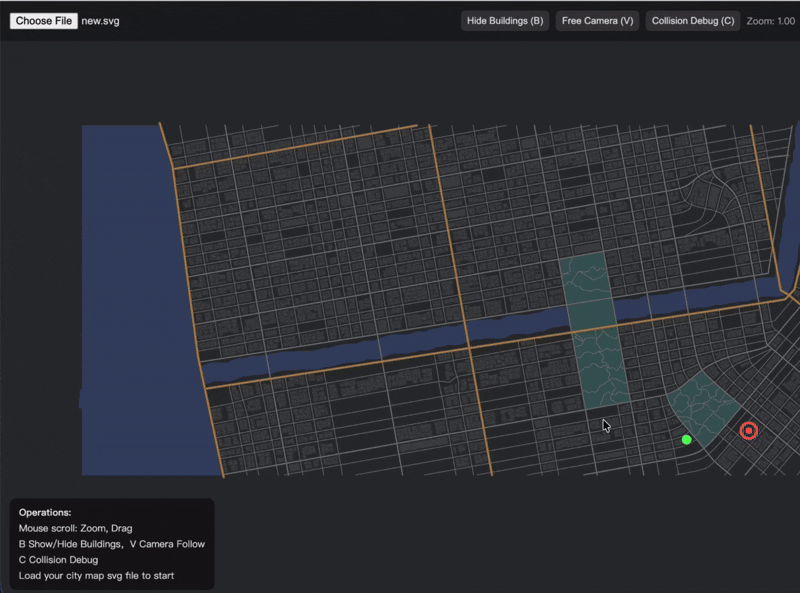</p>

* `legacy2d/rl/`: a top-down environment on MapGenerator SVG maps. Each agent observes a 32x32
  local road mask (an occupancy-grid-like view), its normalised velocity, heading and the
  offset to its goal; rewards combine potential-based progress, collision and off-road penalties
  and stuck detection; training uses a DDPG-style actor-critic with parallel rollouts.
* `legacy2d/play/`: the same world as a manual-driving pygame app.
* `legacy2d/web/`: a browser visualiser sharing the geometry and road-mask code
  (`cd legacy2d/web && sh run.sh`).

The 3D simulator keeps the same maps (`mapgen` writes the original SVG format), so 2D and 3D
experiments can share cities.

---

## Limitations and roadmap

* **Rendering realism.** MuJoCo renders with simple lighting and flat colours; sim-to-real
  transfer would need domain randomisation or the Isaac Sim (RTX) backend.
* **Isaac Sim runtime.** The USD export is tested; the Isaac runner script has not been run
  on an NVIDIA machine yet.
* **Traffic model.** The microsimulation is lane-based: vehicles do not overtake through the
  oncoming lane, so a double-parked van on a one-lane street holds traffic until it leaves.
* **One ego vehicle.** `DrivingEnv` controls a single physical car; multiple physical egos in one
  city are a planned extension (the taxi fleet is multi-agent at the decision level).
* **Highway.** Experimental: one viaduct per city, with ramps at its two ends.
* **Throughput.** Camera rendering bounds the step rate; batched or GPU rendering (MuJoCo MJX /
  Madrona-style) is a natural next step.

---

## Acknowledgements and license

* Road-network generation is ported from
  [ProbableTrain/MapGenerator](https://github.com/ProbableTrain/MapGenerator) (LGPL-3.0).
* 3D models from [Poly Pizza](https://poly.pizza) by Quaternius, Kenney, Kay Lousberg and
  others; full credits in [`CREDITS.md`](CREDITS.md).
* Physics and rendering by [MuJoCo](https://mujoco.org/); USD export for
  [NVIDIA Isaac Sim](https://developer.nvidia.com/isaac/sim).

MetaTraffic is released under the [MIT License](LICENSE), except `mapgen/` and
`third_party/MapGenerator/`, which are under the GNU LGPL v3.0 (see the `COPYING` files there).
