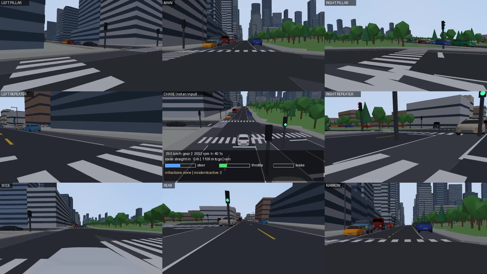
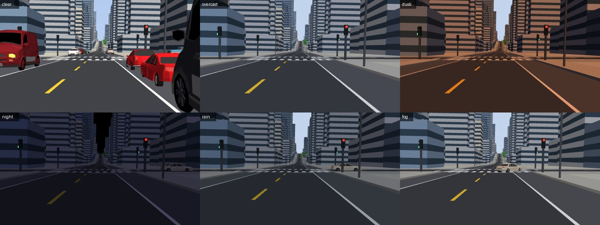

# MetaTraffic 3D

Procedural 3D cities for self-driving and multi-agent traffic research. A seed grows a whole
city, a traffic simulation fills it with cars, pedestrians and incidents, and two simulator
backends render it: **MuJoCo** (runs anywhere, fully tested here) and **NVIDIA Isaac Sim**
(USD export tested; the Isaac runtime script needs an NVIDIA machine and has not been run).

On top of the city there are two learning setups:

* **Camera-only end-to-end driving.** A physical ego car with an engine, gearbox, brakes and
  steering sees the world through eight Tesla-style cameras and outputs steer, throttle,
  brake and gear directly. A privileged expert driver provides demonstrations; a policy with
  an ImageNet-pretrained backbone learns from them, then RL fine-tunes it.
* **Multi-agent taxi fleet.** Every taxi is an agent that picks passengers and routes through
  congestion (MAPPO with a centralised critic).



## Quick start

```bash
pip install -e ".[mujoco,learn,assets]"          # numpy, shapely, mujoco, torch, torchvision, trimesh
python -m metatraffic3d assets fetch              # optional: Poly Pizza models (12 MB); procedural fallbacks otherwise
python -m metatraffic3d build --seed 4 --png map.png
python -m metatraffic3d drive-demo --seed 4 --weather clear --seconds 60 --out demo.mp4
python -m metatraffic3d mjcf --seed 4 --out scenes/seed4 && python -m mujoco.viewer --mjcf scenes/seed4/scene.xml
python -m metatraffic3d usd --seed 4 --out city.usd   # Isaac Sim (needs usd-core)
```

Same seed, same city and same episode: `SimConfig().map.seed` fixes the city, `env.reset(seed=...)`
fixes traffic, pedestrians, passengers, incidents and weather (`tests/test_world.py`,
`tests/test_envs.py`). Exact replay assumes the same library versions (shapely/GEOS, numpy).

## The city

Everything below is drawn from the seed; nothing is forced. `profile.py` samples the global
character of each city and any factor can be pinned in `SimConfig().profile`:

| Factor | Values (probability) |
|---|---|
| terrain | flat 35%, rolling 30%, hilly 25%, steep 10% (hills fade out near water; grades capped ~25%) |
| water | coast 60%, river 65%, independently |
| districts | Dirichlet mix of CBD, commercial, residential, industrial |
| traffic / pedestrian level | 0.6-1.4x / 0.5-1.5x |
| elevated highway (experimental) | 30% |

* **Roads** come from the Python port of ProbableTrain/MapGenerator (`mapgen/`), turned into
  a lane-level network (`roads.py`). Main roads have **8 driving lanes** (4 per direction, a
  median, right-turn lane, dual left-turn lanes); sub-roads have **4 lanes** (one driving and one
  kerb parking lane per direction). Kerbs are filled to at most 80%, so there is always somewhere
  to pull in. Every junction has turn paths with conflict sets; every lane has a way out.
* **Districts** (`zoning.py`) come from smooth fields: distance to downtown, main-road frontage,
  waterfront and outskirts, plus seeded noise. They decide building types and junction control.
* **Buildings** (`heights.py`): detached houses with pitched roofs, apartment blocks, shops with
  glass ground floors and awnings, offices, towers with podiums (height rising toward
  downtown), warehouses. Poly Pizza houses and shops replace procedural ones where they fit.
* **Junction control** (`traffic/control.py`): lights where arterials cross (fixed-time,
  two phases, yellow and all-red), two-way stops where a side street meets an arterial,
  all-way stops in residential streets, some lights downtown.
* **Water and bridges**: sea with a coast strip, a recessed river channel with embankment walls,
  bridges with decks, railings and piers. **Terrain** (`terrain.py`): seeded hills on a height
  field that carries the cars in physics.
* **Elevated highway (experimental)**: when the profile has one, a 2+2-lane 80 km/h viaduct
  runs above the longest straight arterial, grade-separated, with median ramps at both ends
  (the arterial's inner lanes are closed under the ramps). Cars use it in routing, it is drawn
  with deck, barriers and piers, and the ego car can drive on it.

## Traffic, people and incidents (`traffic/`)

Pure-Python microsimulation on the lane network: IDM car-following with vehicle-type and
weather factors, an intersection manager that grants turn paths (conflicts, no blocking the
box, main-road priority, starvation protection, lights and stop signs), mandatory and
discretionary lane changes, kerb parking with pull-in/pull-out, congestion-aware routing.

* **Vehicles**: sedan, SUV, hatchback, pickup, van, taxi, sports car, police car, delivery van,
  truck, bus, garbage truck, ambulance and fire truck, each with its own size and performance.
* **Pedestrians** walk the sidewalks, turn corners, cross on zebras (on red at lights, when clear
  at stops) and sometimes jaywalk; a share of jaywalkers step out without looking.
* **Incidents** (`events.py`) at seeded rates: construction (lane closed with a cone taper and
  barriers, kerb lane coned off, or a whole street closed), broken-down cars, crashes, emergency
  vehicles on a siren run (others change lanes or pull aside; priority at junctions), signal
  outages (junction becomes an all-way stop), hard braking, red-light runners, aggressive cut-ins,
  delivery double-parking.
* **Weather and time of day**: clear, overcast, dusk, night (a dim, street-lit city; car
  headlights are off because MuJoCo's spot lights darken the rest of the scene), rain (road
  friction 0.65), fog; drivers keep longer gaps and slow down in bad conditions.



## Self-driving: camera-only, end-to-end (`driving/`)

| | |
|---|---|
| Ego car | MuJoCo multibody car: 1.3 t chassis, four tyres with contacts, Ackermann steering (rate-limited), rear-wheel drive, engine torque curve (330 N m), 5-speed gearbox + reverse, brakes; slopes and friction from MuJoCo (0-100 km/h 10.7 s, 50-0 km/h in 10.6 m, slows on a 12% hill) |
| Cameras | 8-camera Tesla-like rig (`cameras.py`): main 50°, wide 120°, narrow 35°, two B-pillar, two repeaters, rear; the policy uses 4 by default (main, both pillars, rear) |
| Action | `{"control": [steer, throttle, brake], "gear": R/N/1-5}` - direct control, no speed set-points |
| Observation | camera images + speed, rpm, gear, steering angle, pitch + route command (follow / left / right / straight / U-turn / arrive) |
| Reward | route progress, comfort, penalties for collisions, red lights, stop signs, wrong way, off-road, speeding |
| Ends | arrival, collision, 2 s off the road, 60 s stuck, time limit |

The **expert** (`expert.py`) is a privileged rule-based driver, like the CARLA autopilot used by
LBC, Roach and TransFuser: pure pursuit on the planned lane path, lane changes for turns, and
speed from the simulator's own car-following advice (which already accounts for lights, stop
signs, pedestrians, closures and the car ahead), with an automatic gear schedule. It produces
exactly the policy's action format.

**DriveFormer** (`transformer.py`), the policy, is a time-aware multi-camera transformer in the
spirit of Waymo's Wayformer-style token fusion:

```
4 cameras x last 4 frames (0.2 s apart)  -> frozen ImageNet ResNet-18 -> 3x5 grid -> 15 tokens each
+ a car-state token per frame (speed, rpm, gear, steering, slope)
+ a route-command token
+ learned query tokens (action, future-action chunk, value)
every token: + camera, image-position, token-type embedding
image/state tokens: + Fourier embedding of their age in seconds   <- time awareness
-> 4-layer pre-norm transformer encoder (d=256, 8 heads), 3.24 M trainable parameters
-> action now: steer (tanh), throttle, brake (sigmoid), gear logits (R N 1-5)
-> next 1 s of controls (auxiliary, trajectory-like target), value (for RL)
```

The earlier model (pooled features per camera, concatenated, one branch per route command;
`policy.py`) is kept as a baseline and trains from the same feature cache.

Pipeline: `collect` (expert drives with DART action noise; the label is the clean action) ->
`train-bc --arch transformer` (frame features cached once on disk) -> optional DAgger rounds
(`collect --driver policy`) -> `rl` (PPO on the env reward with a behaviour-cloning term,
time-limit cut-offs bootstrapped) -> `evaluate` (closed-loop on held-out cities and routes).

Backbone features are cached once and compressed 512 -> 64 per token with PCA, so a training
run fits in about 4 GB on a 16 GB Mac (Apple MPS, gradient checkpointing per layer).

Against the usual failure modes of cloning a driver from histories:

* **dead outputs**: throttle and brake are trained with cross-entropy on their logits (an L1 loss
  on a sigmoid that is almost always 0 had pushed the brake into the flat end, where it never
  moved again);
* **copycat**: steps where the expert changes what it is doing (gear changes, braking while
  moving, pulling away) count 5-10x, and half the samples hide their past states (past motion
  dropout, from Waymo's ChauffeurNet);
* **compounding errors**: DAgger rounds where the policy drives and the expert takes over for
  random stretches (30% of the time); every step is labelled with the expert's action;
* **averaged decisions**: at run time only the larger pedal is used, as the expert never presses
  both; otherwise "wait" and "go" average into a half-pressed throttle held by a half-pressed
  brake.

Closed loop on two unseen cities (maps 6 and 2, 5 routes of 300-800 m each, 150 s limit;
`evaluate --seeds 6 2 --episodes 5`):

| Driver | Route completion | Collisions / km | Ends stuck | Speed |
|---|---|---|---|---|
| expert (privileged) | 0.70 | 0 | 0 / 10 | 14 km/h |
| DriveFormer, expert demos only | 0.07 | 3.4 | 0 / 10 | 26 km/h |
| + fixes above, DAgger round 1 | 0.08 | 0 | 5 / 10 | 5 km/h |
| + DAgger round 2, motion dropout | 0.11 | 2.4 | 5 / 10 | 6 km/h |
| + one-pedal rule | 0.12 | 3.6 | 3 / 10 | 9 km/h |
| + DAgger round 3 (8 cities, 4 of them new) | 0.18 | 1.0 | 1 / 10 | 11 km/h |
| + DAgger round 4 (12 cities) | 0.21 | 1.2 | 2 / 10 | 8 km/h |
| round 4 + RL, first run | 0.12 | 1.6 or more ¹ | 1 / 10 | 16 km/h |
| round 4 + RL, second run (fixed exploration and reward) | 0.04 | 0.6 | 1 / 10 | 12 km/h |

¹ That run predates counting a collision once per contact; one car pinned against construction
cones logged a collision on every step, so its exact count is unknown.

The cloned policies are not good drivers yet. Open loop they match the expert closely (steering
error 0.02-0.03 on held-out expert episodes), but in closed loop they fail within a few hundred
metres. The round-2 policy did about as badly on new routes in its training cities (completion
0.13, stuck 4 of 6), so the gap is closed-loop robustness rather than new-city generalisation;
each DAgger round, which labels the states the policy itself drives into, has helped. Round 4
mostly stopped the wrong turns of round 3 (less distance, more of it along the route). One of
the ten routes is blocked even for the expert (no progress in 150 s), and every policy leaves the
road at the same spot on another. The expert
itself runs into the 150 s limit on 8 of its 10 routes, hence 0.70. Over 12 such routes the
round-4 policy gets through 5 of the 8 turns it is asked to make cleanly and all 8 straight
crossings (`drive-demo --policy` records any evaluation route as a video).

RL fine-tuning (`rl`: PPO plus a behaviour-cloning term, 20k steps on 2 training cities) has so
far made the round-4 policy worse. The first run drove twice as fast and ran stop signs: its
exploration noise tapped the brake at random, PPO answered with more throttle, and without the
noise at test time the car was too fast; the reward also made wrong turns and rule breaks cheap.
With both fixed, the second run still left the road on 7 of 10 routes. About 50 episodes of
experience are too few for PPO to improve a policy this fragile. Next to try: a penalty for
drifting from the cloned policy (KL), updating only the output heads, or many more episodes;
more DAgger rounds over more cities remain the step that has reliably helped.

## Multi-agent taxi fleet (`marl/`)

Each taxi is an agent; passengers appear near tall buildings more often, wait a few minutes
and leave if nobody comes. Decisions happen only when needed: an idle taxi chooses one of the
nearest requests or waits; approaching a street with several good ways on, it chooses the
next street. Taxis pick up and drop off in free kerb spots (or double-park with a penalty).
One option-scoring network serves both decisions; training is MAPPO with parameter sharing,
a centralised critic, semi-MDP returns and a behaviour-cloning warm start.

Results on the final simulator (map seed 4, 5 taxis, 120 background cars, 150 pedestrians,
30-minute episodes, 20 held-out demand seeds; `python -m metatraffic3d eval-taxi`):

| Policy | Deliveries / taxi-hour | Abandoned pickups / episode | Earned / episode |
|---|---|---|---|
| random | 0 | 28.0 | 0 |
| greedy (nearest passenger, live ETAs) | 4.54 | 6.9 | 19.6 |
| greedy (free-flow ETAs) | 4.64 | 7.1 | 19.7 |
| greedy-feasible (skips unreachable passengers) | 4.70 | 4.9 | 20.1 |
| **MAPPO** (BC warm start + 40 PPO iterations) | **4.72** | **2.9** | 19.6 |

Paired over the same 20 seeds against the strongest heuristic (greedy-feasible), MAPPO
abandons 2.0 +/- 0.6 fewer pickups per episode, while deliveries (+0.02 +/- 0.13 per taxi-hour)
and earnings (-0.5 +/- 0.5) do not differ. The fleet learned to stop claiming passengers it
cannot reach in time; it did not learn to serve more of them.

## Backends

* **MuJoCo** (`backends/mujoco/`): one compiled model per city; static geometry is visual only,
  a plane or height field carries the cars, traffic and people are pooled mocap bodies, unused
  ones are not drawn, models are merged with a colour-palette texture, traffic-light lamps are
  lit through materials. About 20 ms per 160x96 camera frame on an M4 (no shadows).
* **Isaac Sim** (`backends/isaac/`): USD export with instancing, materials, lamps, prototypes,
  the camera rig and a physics ground (verified with usd-core); a runner script for Isaac Sim
  4.x/5.x that streams the traffic simulation into the stage (not run). See its README.

## Assets

Vehicles, people, street furniture, construction props and some buildings are Poly Pizza
models (`assets/polypizza_manifest.json`): 32 CC0 (Quaternius, Kenney, Kay Lousberg) and 12
CC-BY 3.0, credited by `python -m metatraffic3d assets credits` and in `CREDITS.md`. They are
downloaded on demand into `~/.cache/metatraffic3d/polypizza`; without them every asset has a
procedural fallback. Two Poly Pizza MCP servers exist (HaD0Yun/poly-pizza-mcp,
MatthewHallCom/Poly-Pizza-MCP) for searching with an API key; they are not needed here.

## Limitations

* The Isaac Sim runner has not been run (no NVIDIA GPU here); the USD export is tested.
* Traffic is a lane-based microsimulation: cars cannot overtake through the oncoming lane, so a
  double-parked van on a one-lane street holds traffic until it leaves.
* The expert uses privileged state; the learned policy only sees cameras and its own state.
* MuJoCo renders with simple lighting and no textures; this is not photorealistic, so a
  real-world transfer needs domain randomisation or a better renderer (Isaac/RTX).
* The highway is experimental: only one viaduct per city, with ramps at its two ends.
